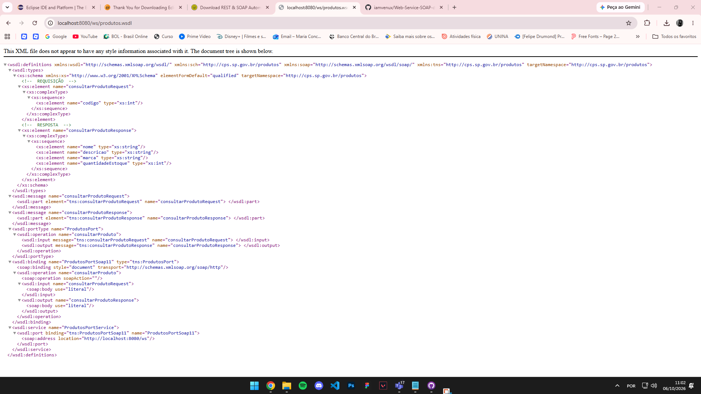
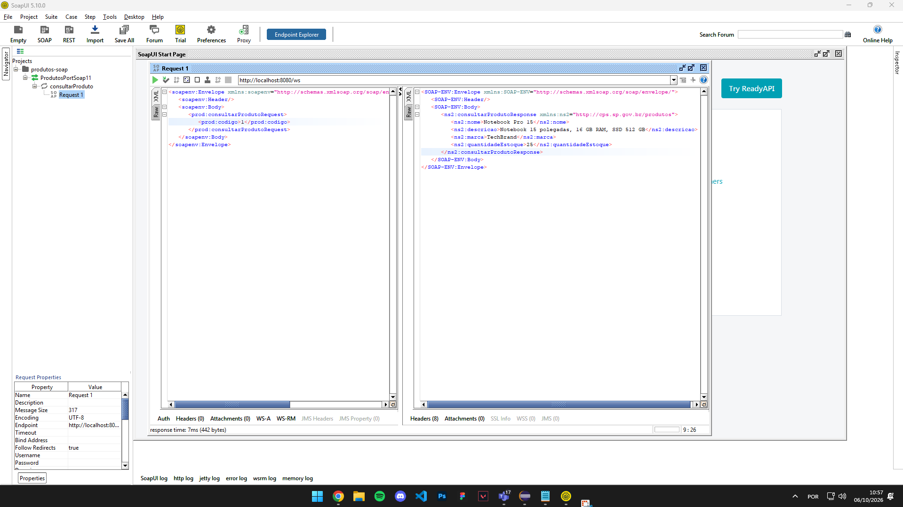
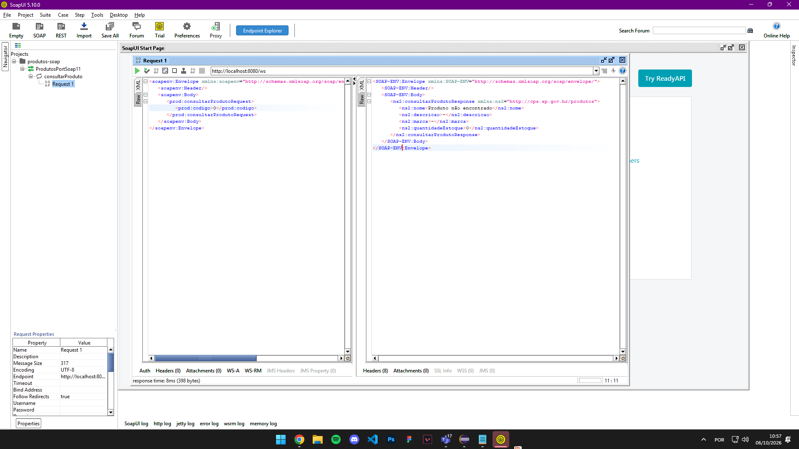

# Web Service SOAP de Produtos

Web Service SOAP (Contract First) feito com Java 17, Spring Boot e Spring Web Services.
Recebe o código de um produto e devolve nome, descrição, marca e quantidade em estoque.

O serviço tem uma camada de segurança com **WS-Security (UsernameToken)**, **exceptions de negócio** e **SOAP Fault** com detalhes do erro.

## Como executar
1. Abra o projeto no Eclipse (File > Import > Maven > Existing Maven Projects).
2. Execute `ProdutosSoapApplication.java` (Run As > Java Application).
3. Acesse o WSDL: http://localhost:8080/ws/produtos.wsdl

## Produtos cadastrados
| Código | Nome | Marca | Estoque |
|---|---|---|---|
| 1 | Notebook Pro 15 | TechBrand | 25 |
| 2 | Mouse Sem Fio | ClickMax | 150 |
| 3 | Teclado Mecânico | KeyPro | 40 |

## Segurança

### WS-Security (UsernameToken)
Toda requisição precisa do cabeçalho `<wsse:Security>` com usuário e senha.
A validação é feita pelo `Wss4jSecurityInterceptor` (Spring WS + Apache WSS4J), configurado em `WebServiceConfig`.

Credenciais padrão (definidas em `application.properties`):

| Propriedade | Variável de ambiente | Padrão |
|---|---|---|
| `ws.security.usuario` | `WS_USUARIO` | `admin` |
| `ws.security.senha` | `WS_SENHA` | `admin123` |

Exemplo de requisição autenticada:

```xml
<soapenv:Envelope xmlns:soapenv="http://schemas.xmlsoap.org/soap/envelope/"
                  xmlns:prod="http://cps.sp.gov.br/produtos">
   <soapenv:Header>
      <wsse:Security soapenv:mustUnderstand="1"
         xmlns:wsse="http://docs.oasis-open.org/wss/2004/01/oasis-200401-wss-wssecurity-secext-1.0.xsd">
         <wsse:UsernameToken>
            <wsse:Username>admin</wsse:Username>
            <wsse:Password Type="http://docs.oasis-open.org/wss/2004/01/oasis-200401-wss-username-token-profile-1.0#PasswordText">admin123</wsse:Password>
         </wsse:UsernameToken>
      </wsse:Security>
   </soapenv:Header>
   <soapenv:Body>
      <prod:consultarProdutoRequest>
         <prod:codigo>1</prod:codigo>
      </prod:consultarProdutoRequest>
   </soapenv:Body>
</soapenv:Envelope>
```

> No SoapUI também é possível usar a aba **Auth > Add New Authorization > Basic** com *WSS-PasswordType: PasswordText*, ou configurar em **WS-Security Configurations**.

### Validação do payload
O `PayloadValidatingInterceptor` valida a requisição contra o `produtos.xsd`. Um código não numérico (ex.: `abc`) retorna SOAP Fault `Client` com o erro de validação.

### Exceptions e SOAP Fault
| Situação | Exception | Fault code | Código no `<detail>` |
|---|---|---|---|
| Produto inexistente | `ProdutoNaoEncontradoException` | `Client` | `PRODUTO_NAO_ENCONTRADO` |
| Código ≤ 0 | `CodigoInvalidoException` | `Client` | `CODIGO_INVALIDO` |
| Sem cabeçalho WS-Security / senha errada | (tratado pelo WSS4J) | `Client` | — |
| Erro inesperado | qualquer outra | `Server` | — (mensagem genérica) |

As exceptions de negócio estendem `ServiceFaultException`. O `DetailSoapFaultDefinitionExceptionResolver` converte a exception em SOAP Fault e escreve o elemento `consultarProdutoFault` (definido no XSD e publicado no WSDL como `wsdl:fault`) dentro do `<detail>`.

Exemplo de resposta para o código 99:

```xml
<SOAP-ENV:Envelope xmlns:SOAP-ENV="http://schemas.xmlsoap.org/soap/envelope/">
   <SOAP-ENV:Body>
      <SOAP-ENV:Fault>
         <faultcode>SOAP-ENV:Client</faultcode>
         <faultstring xml:lang="en">Produto com código 99 não encontrado.</faultstring>
         <detail>
            <ns2:consultarProdutoFault xmlns:ns2="http://cps.sp.gov.br/produtos">
               <ns2:codigo>PRODUTO_NAO_ENCONTRADO</ns2:codigo>
               <ns2:mensagem>Produto com código 99 não encontrado.</ns2:mensagem>
            </ns2:consultarProdutoFault>
         </detail>
      </SOAP-ENV:Fault>
   </SOAP-ENV:Body>
</SOAP-ENV:Envelope>
```

## Estrutura
```
produtos-soap/src/main/java/br/gov/sp/cps/produtos_soap
├── config/WebServiceConfig.java          # WSDL, WS-Security, validação e resolver de Fault
├── endpoint/ProdutoEndpoint.java         # operação consultarProduto
└── exception/
    ├── ServiceFaultException.java        # base das exceptions de negócio
    ├── ProdutoNaoEncontradoException.java
    ├── CodigoInvalidoException.java
    └── DetailSoapFaultDefinitionExceptionResolver.java
```

## WSDL


## Teste no SoapUI
Importe `produtos-soap-soapui-project.xml`. Ele já traz as requisições:

1. Produto encontrado (autenticado)
2. Produto não encontrado (SOAP Fault)
3. Código inválido (SOAP Fault)
4. Código não numérico (validação XSD)
5. Sem WS-Security (SOAP Fault)
6. Senha incorreta (SOAP Fault)

Produto encontrado (código 1):



Produto inexistente (código 99):


